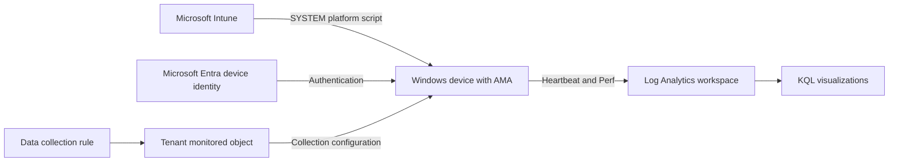

# Monitor Intune-Managed Windows Devices With AMA

Deploy Azure Monitor Agent (AMA) silently through Microsoft Intune, collect
Windows performance counters in Azure Log Analytics, and use KQL charts to
investigate CPU, memory, disk, and process activity.

This guide describes the workflow implemented in this repository. The
[lab runbook](LAB-RUNBOOK.md) preserves sanitized lab deployment evidence and
troubleshooting history. Public examples use fictional identities, not live targets.

## Architecture And Scope



Intune controls which devices receive the installer. The DCR controls which
counters AMA collects and how frequently it samples them. AMA uses Microsoft
Entra device tokens, not workspace shared keys. Azure Arc is not required for
this Windows client-installer workflow.

> **Tenant-wide configuration:** A DCR associated with the monitored object
> applies to all devices in the tenant running AMA installed with the Windows
> client installer. An Intune pilot group does not restrict that association.
> Inspect existing associations and coordinate changes with their owners.

## Prerequisites

- A supported Windows client OS, x64 for this repository's installer, enrolled
  in Intune and Microsoft Entra joined or hybrid joined. Registration or Intune
  enrollment alone does not meet the AMA client prerequisite.
- Healthy device authentication. Run `dsregcmd /status` on the endpoint and
  check `AzureAdJoined : YES`, `DeviceAuthStatus : SUCCESS`, and the tenant ID.
- An Azure subscription and permission to create the workspace and DCR, plus
  workspace query access. Creating and associating the tenant monitored object
  requires separate tenant-scope authorization; subscription access alone may
  not suffice. Follow Microsoft's role assignment guidance linked below.
- Intune licensing and administrative authorization to assign platform scripts
  and manage the pilot device security group.
- Azure CLI and Windows PowerShell on the administration workstation.
  Automated Intune publishing also requires `Microsoft.Graph.Authentication`.
- HTTPS access to the AMA control and ingestion endpoints listed in the
  [Windows client documentation](https://learn.microsoft.com/en-us/azure/azure-monitor/agents/azure-monitor-agent-windows-client),
  plus the Microsoft installer download endpoints used by the script.

The client installer is intended mainly for always-connected desktops and
workstations. Laptop battery use, intermittent connectivity, and hibernation
require additional evaluation. This is not the VM-extension or server/Arc workflow.

## Adapt The Lab Before Running

The scripts default to single-device guards and contain fictional example values
such as `admin@contoso.example`, `CONTOSO-PC`, and repeated-digit GUIDs. Inline
comments identify the values to replace. They are not a tenant-neutral deployment
framework and will reject real accounts until configured. Update values across
scripts and test fixtures consistently; do not remove the safety checks.
The opt-in security-group workflow below replaces per-device targeting with an
Intune group assignment while retaining tenant and endpoint health checks.

| File | Values or behavior to review |
| --- | --- |
| [infra/azuredeploy.json](infra/azuredeploy.json) | Workspace and DCR names, region, retention, daily cap, counter selection. |
| [infra/monitored-object.json](infra/monitored-object.json) | Region, which must match the DCR. |
| [scripts/Get-EnrollmentInventory.ps1](scripts/Get-EnrollmentInventory.ps1) | Expected account, tenant, device names and identities. |
| [scripts/Install-AzureMonitorAgent.ps1](scripts/Install-AzureMonitorAgent.ps1) | Tenant ID in all modes; expected computer name and local Entra device ID in single-device mode only. |
| [scripts/Publish-IntuneAgent.ps1](scripts/Publish-IntuneAgent.ps1) | Account and tenant in all modes; device IDs, group/script names and ownership marker in single-device mode only. Use `-TargetSecurityGroupId` for an existing device security group. |
| [scripts/Set-MonitoringCollection.ps1](scripts/Set-MonitoringCollection.ps1) | Account, tenant, subscription, resource group, DCR and association identifiers. |
| [tests/Test-DeploymentScripts.ps1](tests/Test-DeploymentScripts.ps1) | Fixtures and assertions corresponding to the adapted guards. |
| [queries](queries) | Target device and hardware-specific query parameters. |

An Intune managed-device ID, an Entra directory object ID, and an Entra device
ID are different identifiers. Verify the mapping rather than substituting one
for another. The original lab had two directory records for one physical PC;
that is a lab-specific condition, not a prerequisite or recommended topology.

Run the local tests after adaptation. They use mocks and function-level checks;
they do not install AMA or prove cloud permissions and telemetry delivery.

```powershell
.\tests\Test-DeploymentScripts.ps1
```

## 1. Prepare Azure

Run these commands from the repository root on the administration workstation.
Replace the placeholders and review the template before deploying. Changing
these shell variables does not update the hardcoded values inside the scripts.

```powershell
$tenantId = '<your-tenant-id>'
$subscriptionId = '<your-subscription-id>'
$resourceGroup = '<your-resource-group>'
$location = 'indonesiacentral'
az login --tenant $tenantId
az account set --subscription $subscriptionId
az account show --query '{tenant:tenantId,subscription:id,user:user.name}'
az group create --name $resourceGroup --location $location
az deployment group create --resource-group $resourceGroup --template-file .\infra\azuredeploy.json --parameters samplingSeconds=10
```

Check each command succeeds before continuing. The template creates a workspace
and Windows DCR, not the monitored object or its association. Its defaults are
Indonesia Central, 30-day retention, and a 1 GB daily ingestion cap. The region
above does not override the template's hardcoded resource locations.

After obtaining the required tenant-level permissions, inspect any existing
monitored object and associations. If the object already exists, reuse it only
after confirming compatibility; do not overwrite its location blindly. For a
new monitored object, with the JSON location matching the DCR:

```powershell
$monitoredObjectUrl = "https://management.azure.com/providers/Microsoft.Insights/monitoredObjects/${tenantId}?api-version=2021-09-01-preview"
az rest --method put --url $monitoredObjectUrl --body '@infra/monitored-object.json'
```

This project used the preview monitored-object API above and the `2023-03-11`
DCR association API. Verify supported API versions when adapting the deployment.
Do not associate the new DCR until the pilot installation has been verified.
Existing tenant associations can configure a newly installed agent immediately.

## 2. Install AMA Through Intune

Choose one publishing method. Do not run the endpoint installer manually.

### Repository Automation

After adapting the identity guards, authenticate and inspect the inventory:

```powershell
.\scripts\Get-EnrollmentInventory.ps1 -DeploymentAccess
.\scripts\Publish-IntuneAgent.ps1 -WhatIf
.\scripts\Publish-IntuneAgent.ps1
```

The inventory script uses delegated Microsoft Graph authentication. The publisher
requires these consented scopes and appropriate administrative authorization:

- `DeviceManagementScripts.ReadWrite.All`
- `Group.ReadWrite.All`
- `Device.Read.All`
- `DeviceManagementManagedDevices.Read.All`

The lab's script endpoint rejected the legacy
`DeviceManagementConfiguration.ReadWrite.All` scope. The publisher uses Graph
beta APIs, validates group membership and installer content, and refuses
unexpected assignments. It does not implement a general script update pipeline.
`-WhatIf` can return early when a dependent object does not exist, so it is not
a complete simulation of later publishing steps.

### Target An Existing Security Group (Two Or More Devices)

Use this option instead of the single-device publishing commands above.

1. In Microsoft Entra, create a **Security** group with **Assigned** membership.
   Add the correct Intune-managed Windows **device objects** directly and copy
   the group's **Object ID**. Empty groups, dynamic groups, mail-enabled groups,
   users, nested groups, disabled devices, non-Windows devices, and devices
   without a matching Intune Windows record are rejected at publication time.
2. Set the real tenant ID in the installer and publisher, and the authorized
   administrator UPN in the publisher. Leave the installer's default
   `TargetingMode = 'SingleDevice'` unchanged. The single-device computer names
   and device-ID examples are not used by group-targeted deployments.
3. On the Windows administration workstation, authenticate to Graph using the
   same consented scopes listed above. Install `Microsoft.Graph.Authentication`
   first if it is missing:

   ```powershell
   Import-Module Microsoft.Graph.Authentication
   Connect-MgGraph -TenantId '<your-tenant-id>' -Scopes @(
       'DeviceManagementScripts.ReadWrite.All'
       'Group.ReadWrite.All'
       'Device.Read.All'
       'DeviceManagementManagedDevices.Read.All'
   ) -UseDeviceCode -ContextScope CurrentUser -NoWelcome
   ```

4. From the repository root, preview and then publish:

   ```powershell
   $targetGroupId = '<your-device-security-group-object-id>'
   .\scripts\Publish-IntuneAgent.ps1 -TargetSecurityGroupId $targetGroupId -WhatIf
   .\scripts\Publish-IntuneAgent.ps1 -TargetSecurityGroupId $targetGroupId
   ```

The publisher validates current direct group members, including paginated
results, and does not create the group or add/remove members. It creates a
separate platform script identified by the group ID and assigns it only to that
group. It changes only the **uploaded** installer's default to `SecurityGroup`;
the local installer remains single-device by default. The reported
`InstallerSHA256` hashes the uploaded bytes, which differ from the local file
in group mode. Existing script content/settings or assignment conflicts are
rejected rather than silently overwritten.

In group mode, the endpoint still requires SYSTEM, x64 PowerShell, a healthy
Entra join, the expected tenant, and a valid device ID. It does not check a
hardcoded computer name or device ID, or call Graph to recheck group membership.
**Intune assignment is the installation-targeting boundary.** Restrict who can
edit group membership and script assignments; later eligible members can receive
the installer without republishing. Publication-time validation is not continuous
enrollment monitoring. Removing a member does not uninstall AMA or stop collection.

Continue with installation and telemetry verification for **each** device below.
No extra workspace or DCR is needed per device when they share the same settings.
The monitored-object DCR association, including Start/Stop and sampling changes,
remains **tenant-wide for AMA Windows client installations**, not group-scoped.
The collection-control script is unchanged.

### Intune Admin Center

Alternatively, open **Devices > Scripts and remediations > Platform scripts >
Add > Windows 10 and later** and upload the adapted
[installer](scripts/Install-AzureMonitorAgent.ps1).
For manual multi-device group targeting, change only the top-level parameter
default to `TargetingMode = 'SecurityGroup'` in the copy you upload, configure
the tenant ID, and assign that copy to your verified device security group.
The function-level default need not change. Do not use this modified local
copy with the automated publisher, which expects the original single-device
default. The same group-targeting boundaries and limitations above apply.

| Setting | Value |
| --- | --- |
| Run this script using the logged on credentials | No, to run as SYSTEM. |
| Run script in 64-bit PowerShell host | Yes. |
| Enforce script signature check | No for the unsigned lab script. |
| Assignment | A dedicated device security group containing the verified pilot device, or verified Windows devices with a group-targeted installer. |

Production signing requires a trusted signing process and corresponding
publisher changes. Disabling platform-script signature enforcement does not
disable the installer's Microsoft Authenticode checks on downloaded binaries.

The installer checks tenant/join health and, by default, the individual device
identity, installs the VC++ runtime if needed,
downloads the Microsoft-signed AMA MSI, and installs silently without forcing
a restart. An existing AMA service skips installation; this is not an automatic
upgrade solution.

## 3. Verify Installation And Activate Collection

On the endpoint, use **Settings > Accounts > Access work or school**, select the
existing managed connection, then **Info > Sync**. Allow time for Intune and
the Intune Management Extension (IME) to process the assignment.

- Check the platform script's **Device status** in Intune. Assignment success
  alone does not establish installation success; reporting can lag execution.
- Check `Get-Service AzureMonitorAgent` and the installed application version.
- Inspect IME logs under `%ProgramData%\Microsoft\IntuneManagementExtension\Logs`,
  particularly `AgentExecutor.log`, for the matching script execution and exit code.
- Inspect `%ProgramData%\ContosoDeviceMonitoring\<run-guid>\install.log` and the
  MSI log when present. Access protected logs with authorized permissions;
  do not weaken their ACLs.

After verifying installation and reviewing tenant scope, run these on the
administration workstation using the adapted collection-control script:

```powershell
.\scripts\Set-MonitoringCollection.ps1 -Action SetInterval -SamplingSeconds 10
.\scripts\Set-MonitoringCollection.ps1 -Action Start -AcknowledgeTenantScope
.\scripts\Set-MonitoringCollection.ps1 -Action Status
```

`SetInterval` does not start collection. `Start` creates the project association
when needed, without changing the interval. `Status` reports configuration,
not proof of agent runtime or ingestion.

## 4. Verify Telemetry In Log Analytics

Open the destination workspace in Azure Portal, select **Logs**, and switch
from **Simple mode** to **KQL mode**. Run this query and identify the expected
device's `Computer` value:

```kusto
union withsource=TableName Heartbeat, Perf
| where TimeGenerated > ago(24h)
| summarize Records=count(), Latest=max(TimeGenerated) by TableName, Computer
| order by Computer asc, TableName asc
```

Recent Heartbeat and Perf records establish delivery. An empty result is not
by itself an installation failure: check the workspace, time range, DCR
destination and association, network access, agent health, and ingestion cap.
Initial setup also requires configuration propagation and ingestion time.

## 5. Run Insightful Visualizations

Open one query file below, place its complete contents in the Logs KQL editor,
adjust its parameters, and select **Run**. Each file contains a `render`
statement. Run queries separately rather than combining all files in one editor.

| Query | What to investigate |
| --- | --- |
| [01: Resource pressure](queries/01-resource-pressure.kql) | Whether CPU peaks coincide with physical RAM pressure. |
| [02: Top process CPU](queries/02-top-process-cpu.kql) | Which process-name groups consume the most CPU on average. |
| [03: Process memory trends](queries/03-process-memory-trends.kql) | Growing private working sets and high-memory process-name groups. |
| [04: Disk latency](queries/04-disk-latency.kql) | Elevated sampled read/write latency, expressed in milliseconds. |
| [05: Disk free space](queries/05-disk-free-space.kql) | Volumes approaching capacity and declining free-space trends. |
| [06: Disk throughput](queries/06-disk-throughput.kql) | Read/write transfer activity in MiB/s for each physical disk. |
| [07: Collection coverage](queries/07-collection-coverage.kql) | Missing expected CPU samples in completed time buckets. |
| [08: Ingestion volume](queries/08-ingestion-volume.kql) | Billable data volume by table or performance object, using ingestion time. |

### Customize The Parameters

- Set `Device` to the exact `Computer` value observed in telemetry.
- Set `Lookback` to the incident window and align the portal time selector.
- Set `Grain` to the desired chart aggregation interval where available.
  This does not change collection frequency.
- Set `TotalPhysicalBytes` in query 01 to the target device's physical memory.
  Obtain it with `(Get-CimInstance Win32_ComputerSystem).TotalPhysicalMemory`.
- Set `LogicalProcessors` in query 02 to the target device's logical CPU count.
  Obtain it with `(Get-CimInstance Win32_ComputerSystem).NumberOfLogicalProcessors`.
- Set `TopCount` where available and `ExpectedSamplingSeconds` in query 07 to
  the actual configured sampling interval. Avoid windows spanning interval changes.

Start with resource pressure, narrow the time window around an incident, then
compare process CPU/memory and disk latency/throughput. Check coverage before
interpreting an apparent recovery: missing telemetry is not evidence of low load.
These files are standalone charts; this repository does not deploy a dashboard,
Workbook, or alert rules.

### Interpret Results Carefully

Process instance names and PIDs can be reused. Process-name charts do not track
unique process lifetimes, and rising memory alone does not prove a leak. Use
PID, elapsed time, and timestamps for deeper investigation; do not average PIDs.
Process I/O counters are not equivalent to physical disk traffic.

Physical RAM usage in query 01 is derived from available memory and device
capacity. `% Committed Bytes In Use` measures something different. Disk latency
charts summarize sampled counter values, not individual request percentiles.
Coverage can show zero before collection began and recent buckets can backfill.
Ingestion volume is not a currency-denominated bill or total Azure cost.

## Change Sampling, Stop, And Resume

Run each operation intentionally; these examples are not a batch to execute:

| Operation | Command |
| --- | --- |
| Read configuration | `.\scripts\Set-MonitoringCollection.ps1 -Action Status` |
| Sample every 60 seconds | `.\scripts\Set-MonitoringCollection.ps1 -Action SetInterval -SamplingSeconds 60` |
| Preview stopping | `.\scripts\Set-MonitoringCollection.ps1 -Action Stop -WhatIf` |
| Stop this project's collection | `.\scripts\Set-MonitoringCollection.ps1 -Action Stop` |
| Resume with the current interval | `.\scripts\Set-MonitoringCollection.ps1 -Action Start -AcknowledgeTenantScope` |

Stop removes associations to this project's DCR, preserving unrelated DCRs,
the agent installation, and retained historical data. It does not guarantee
heartbeat or other collection stops. Changes propagate asynchronously and
buffered data may arrive afterward. Verify new sample timestamps, not only
the configuration response.

Sampling is not upload timing. The project observed approximately 10-second
CPU record spacing; it has not established one-second stored granularity.
Although a one-second interval was accepted by Azure, `Start` rejects it as a
baseline. There is no automatic timed diagnostic-and-restore workflow here.

Process counters can dominate ingestion volume. Start with a small pilot and
measure sustained volume before expanding. The lab's daily cap can cause gaps
and is not a hard spending ceiling. Consider 60-second sampling or fewer process
counters, and evaluate retention, privacy, access control, and budgets.

Removing an Intune script assignment does not uninstall AMA. Upgrade and
uninstall deployments through Intune require a separate, tested lifecycle
implementation; neither is supplied by this repository.

## Validation And Publication

The recorded lab run on September 25, 2026 verified Intune SYSTEM/x64 execution,
AMA installation, Heartbeat, all 18 configured counter types, approximately
10-second CPU record spacing, and nonempty results from all eight visualization
queries. This is evidence from one environment, not a compatibility guarantee.

One-second stored granularity, stop/start propagation timing, sustained cost,
and portal chart appearance remain unverified. Local tests do not replace
pilot deployment and ingestion checks.

Before pushing to a public repository, review the entire repository and Git
history for account names, device identifiers, tenant/subscription metadata,
logs, and screenshots. Identifiers are not authentication secrets but can expose
environment details. Exclude tokens, authentication caches, credentials,
private keys, and recovery keys. The public source uses sanitized examples;
recheck any later local edits before committing real deployment values.
Choose an appropriate repository license before distributing the project.

## References

Microsoft documentation checked September 25, 2026. Confidence is high for the
documented prerequisite and scope rules; lab validation boundaries are listed above.

- [AMA Windows client setup, permissions, scope, and limitations](https://learn.microsoft.com/en-us/azure/azure-monitor/agents/azure-monitor-agent-windows-client)
- [Deploy Windows PowerShell scripts with Intune](https://learn.microsoft.com/en-us/intune/device-management/tools/run-powershell-scripts-windows)
- [Project runbook and deployment evidence](LAB-RUNBOOK.md)